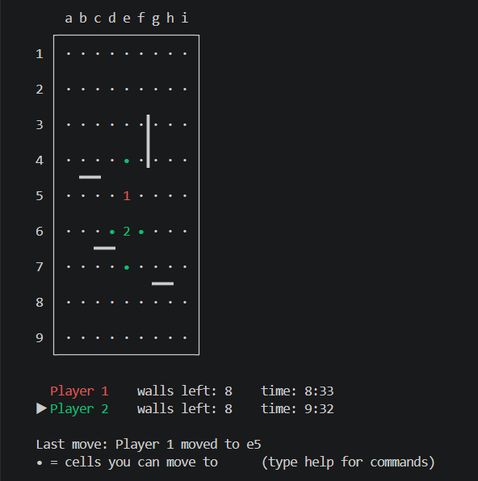

# Quoridor


A terminal version of the board game Quoridor for two or four players, written in plain Python with no runtime dependencies. Race your pawn to the opposite side of the board, and place walls to slow your opponents down.



## Features

- Two or four players on a 9x9 board, with the standard wall counts (10 each for two players, 5 each for four)
- Jumping over adjacent pawns, including the diagonal sidestep when a wall or the board edge is behind the pawn
- Walls are refused if they would overlap or cross another wall, or trap a player with no route to their goal (checked with a breadth-first search)
- Colour display: the player to move is green, opponents are red
- Cells you can move to are marked on the board
- In two player games the board turns around each turn, so whoever is playing sees their own side at the bottom (switch it off with `--no-flip` or the `flip` command)
- Wall counts for every player shown under the board
- `undo`, `history`, `help` and `resign` commands
- Optional chess-style clock: at the start of a two player game you choose no time limit, 5 minutes or 10 minutes each
- A test suite that covers the rules, the game flow, the display and the interface

## Get the game

You need Python 3.9 or newer from python.org. On Windows, tick "Add python.exe to PATH" in the installer.

1. Download the code: click **Code** > **Download ZIP** on the GitHub page and unzip it, or run `git clone https://github.com/radhikasinghal0112-source/Quoridor.git`.
2. Open a terminal in the folder that contains the `quoridor` folder.
3. Start the game with the command in the next section.

Or install it with pip and start it from anywhere:

```
pip install git+https://github.com/radhikasinghal0112-source/Quoridor.git
quoridor
```

## Quick start

```
python -m quoridor
```

On Windows, if `python` is not found, use `py -m quoridor`.

At the start of a two player game you are asked for a time limit: no limit, 5 minutes or 10 minutes per player. The answer is kept for rematches.

Options:

| Option | Meaning |
| --- | --- |
| `--players 2` or `--players 4` | Number of players (default 2) |
| `--walls N` | Walls per player (default 10 for two players, 5 for four) |
| `--time MINUTES` | Give each player a clock with this many minutes, and skip the time limit question (two players only) |
| `--untimed` | Play without a clock, and skip the time limit question |
| `--increment SECONDS` | Seconds added to a player's clock after each move |
| `--no-color` | Turn colours off (also off when the `NO_COLOR` environment variable is set) |
| `--no-flip` | Keep the board the same way up instead of turning it for each player |
| `--no-clear` | Do not clear the screen between turns |

## How to play

On your turn, either move your pawn one cell or place a wall.

| Command | What it does |
| --- | --- |
| `move e5` (or `m e5`) | Move to a neighbouring cell |
| `wall d3 h` (or `w d3 h`) | Place a horizontal (`h`) or vertical (`v`) wall |
| `flip` | Turn the board view on or off (two player games) |
| `undo` | Take back the last turn (time already used is not refunded) |
| `history` | List every move so far |
| `resign` | Give up (two player games) |
| `help` | Show the command list |
| `quit` | Leave the game |

Cells are named like chess squares: a column letter `a` to `i` and a row number `1` to `9`, with row 1 at the top. When the board is turned for a player, the letters and numbers turn with it, so a cell keeps its name.

A wall is named after the cell whose bottom right corner it is anchored on. `wall d3 h` lies just below cells `d3` and `e3`. `wall d3 v` lies just to the right of cells `d3` and `d4`.

### Rules

- Each player starts in the middle of an edge and wins by reaching any cell on the opposite edge. In a four player game the players start at the top, right, bottom and left, in that order.
- A wall is two cells long. It cannot run along the outer edge of the board, overlap another wall or cross another wall. Touching at an end, or forming a T, is fine.
- A wall may not leave any player without a route to their goal. Pawns do not count as blocking a route, only walls do.
- If a pawn is directly in front of you, you may jump straight over it. If a wall, the edge of the board or another pawn is directly behind it, you may instead step diagonally to either side of it, unless a wall blocks that step.

## Design notes

The rules live in `quoridor/board.py` and know nothing about the terminal.

- **Cells** are `(row, col)` pairs from 0 to 8, with `(0, 0)` at the top left.
- **Walls** are anchored on a *corner*, the point where four cells meet. A wall at `(row, col)` sits on the corner at the bottom right of that cell. A horizontal wall covers columns `col` and `col + 1`. A vertical wall covers rows `row` and `row + 1`. Both orientations use anchors from 0 to 7, so a wall can never hang off the board.
- **Collision rules** become short checks with corner anchors. Two walls cross when they have the same anchor and different orientations. Two horizontal walls overlap when they share a row and their columns differ by 1. Vertical walls work the same way with rows.
- **Blocked edges.** Each wall is also stored as the two cell-to-cell edges it blocks, kept in a set. Movement, jumping and the route search all ask the same cheap question: is this edge blocked?
- **The route check** places the wall tentatively, runs a breadth-first search for every player, and takes the wall back if anyone is trapped.

## Project layout

```
quoridor/
  board.py        Pawns, walls, movement, jumping, placement rules
  pathfinding.py  Breadth-first search used by the route check
  game.py         Turns, history, undo, win conditions and the chess clock
  render.py       Drawing the board and status panel, with optional colour
  notation.py     Cell and wall names such as e5 and d3 h
  cli.py          The terminal interface and the command parser
tests/            pytest tests for every module
docs/             The screenshot shown above
.github/          Workflow that runs the tests on every push
```

## Tests

```
pip install -r requirements.txt
python -m pytest
```

The clock is injected into the game as a function, so the tests simulate time passing instead of waiting.

## Known limitations and ideas

- The clock updates when a move is submitted. A terminal waiting at a prompt cannot tick down live, so a player who runs out of time is told so when they next press Enter. A live countdown would need threads or a library such as `curses`.
- The clock is only available in two player games.
- Ideas for later: a computer opponent, saving and loading games, and a browser front end on top of the existing rules module.

## License

Released under the MIT License. See the `LICENSE` file.
